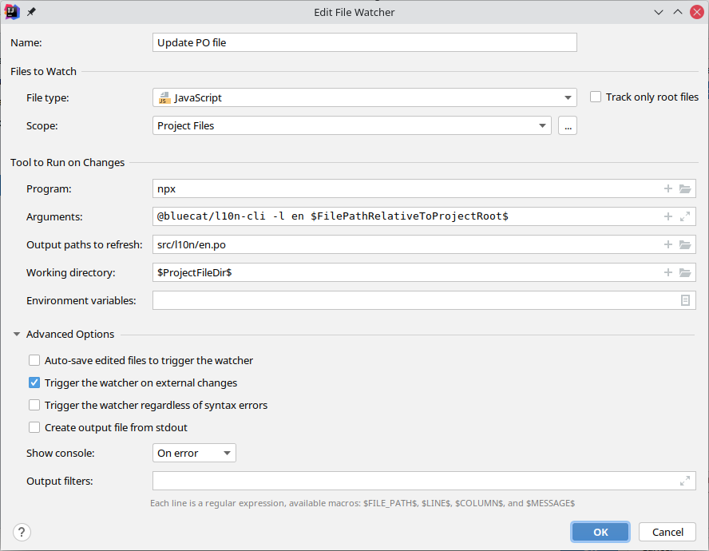

# `@bluecateng/l10n-cli`

Command line utilities for l10n.

Upgrading from an older major version? See the [migration guide](https://github.com/bluecatengineering/l10n-packages/blob/master/MIGRATION.md).

## Installation

```shell
npm i -D @bluecateng/l10n-cli
```

The command line is a native executable, the package contains the executables for these platforms:

- macOS on Apple silicon (arm64) and Intel (x64).
- Linux on arm64 and x64, the executables are statically linked so they run on any distribution, including the ones
  which use musl, such as Alpine.

When installed with npm, an install script replaces the `l10n-cli` command with the executable for the current platform,
so it runs without starting Node.
If the install script does not run (other package managers, `--ignore-scripts`, or npm blocking the install scripts of
dependencies), the command starts Node to run the executable, which takes a few more milliseconds.
To allow the install script with npm:

```shell
npm install-scripts approve @bluecateng/l10n-cli
```

Because the install script puts the executable for the current platform in place of the command, a `node_modules`
directory installed on one platform does not work on another. For example, `node_modules` installed on macOS and then
copied or mounted into a Linux container fails with "exec format error".
Install the dependencies on the platform where the command runs, for example by running `npm ci` inside the container
and excluding `node_modules` from what is copied into it (`.dockerignore`).

## Configuration

Add an object with this format to `package.json`. All paths are relative to the directory where `package.json` is located.
The configuration is searched in the `package.json` of the current directory and its ancestors.
Other configuration files (`.bc-l10nrc`, `.bc-l10nrc.json`, `.bc-l10nrc.yaml`, `bc-l10n.config.js`, etc.) are not supported.

```
"bc-l10n": {
  "hashLength": <number>,
  "sourcePath": <string>,
  "module": <string>,
  "catalogPath": <string>,
  "locales": <Array<string>>
}
```

### hashLength

To save space in production the code only contains a hash of the original string.
This field specifies the length to which the hashes will be truncated.
It should be the minimum length which avoids clashes, clashes are validated at build time.

- Required: yes
- Example: `3`

### sourcePath

The path to the sources.

- Required: no
- Default: `"src"`

### module

The path to the module which loads the strings (see `@bluecateng/l10n-core`).

- Required: yes
- Example: `"src/l10n"`

### catalogPath

The path where the message catalog files will be created.
It must contain the token "{locale}" which will be replaced with the corresponding locale.
It must not contain an extension, the extension will be appended on generation.

- Required: yes
- Example: `"src/l10n/{locale}"`

### locales

List of [BCP-47](https://www.rfc-editor.org/rfc/bcp/bcp47.txt) locale codes.

- Required: no
- Default: `["en"]`
- Example: `["en", "fr"]`

## Usage

### Extracting strings

The command line can be used in two modes:

- during development to extract strings from individual files for a single locale.
- before committing to extract strings from all source files for all configured locales.

`npx @bluecateng/l10n-cli [ -c ] [ -l <locale> ] [ <file-paths> ... ]`

#### -c, --clean

Removes the obsolete entries from the catalogs.

#### -l, --locale

The single locale code to update. If not specified, all the configured locales will be updated,
and the entries which are no longer used are marked as obsolete.

#### -h, --help

Prints the usage and exits.

#### file-paths

The paths to the source files from which strings will be extracted.
If not specified, all the source files will be scanned.

### Building catalogs

Compiles the `.po` catalog for every configured locale into a `.po.js` module that can be imported directly (see `@bluecateng/l10n-core`).

`npx @bluecateng/l10n-cli build <outDir>`

#### outDir

The directory where the compiled `.po.js` files will be written.
Each catalog is written at the path corresponding to its `catalogPath`, made relative to `sourcePath` and rooted at `outDir`.

- Example: with `sourcePath` `"src"` and `catalogPath` `"src/l10n/{locale}"`, the `en` catalog is written to `<outDir>/l10n/en.po.js`.

The messages can use the `number`, `date` and `time` argument types with the styles supported by
`Intl.NumberFormat` and `Intl.DateTimeFormat`, skeletons (`::currency/USD`) are not supported.
Obsolete entries are not included.

### Supported syntax

The source files are parsed as TypeScript, files with the extensions `.js`, `.jsx` and `.tsx` can also contain JSX.
JSX is not allowed in `.ts` files, where it would conflict with type assertions (`<Type>value`).

Proposals which are not yet part of the language, such as `do` expressions, are not supported and are reported as
syntax errors.

## Usage as a file watcher in JetBrains IDEs (WebStorm/IDEA)

This configuration can be added under Settings > Tools > File Watchers.


